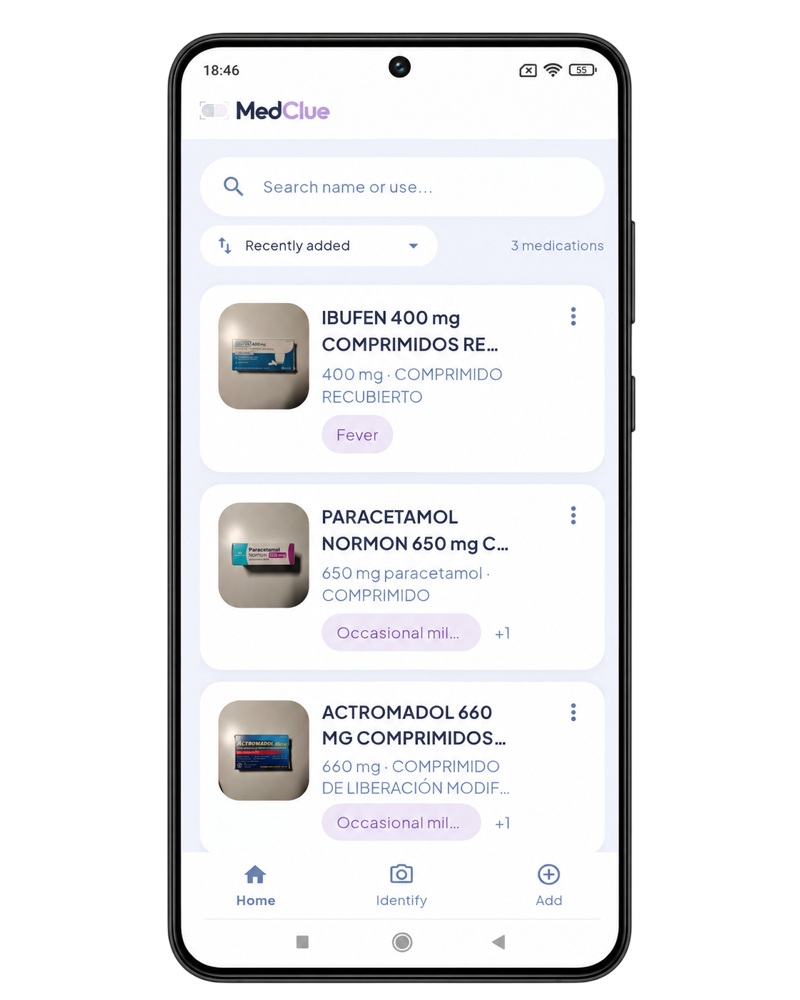
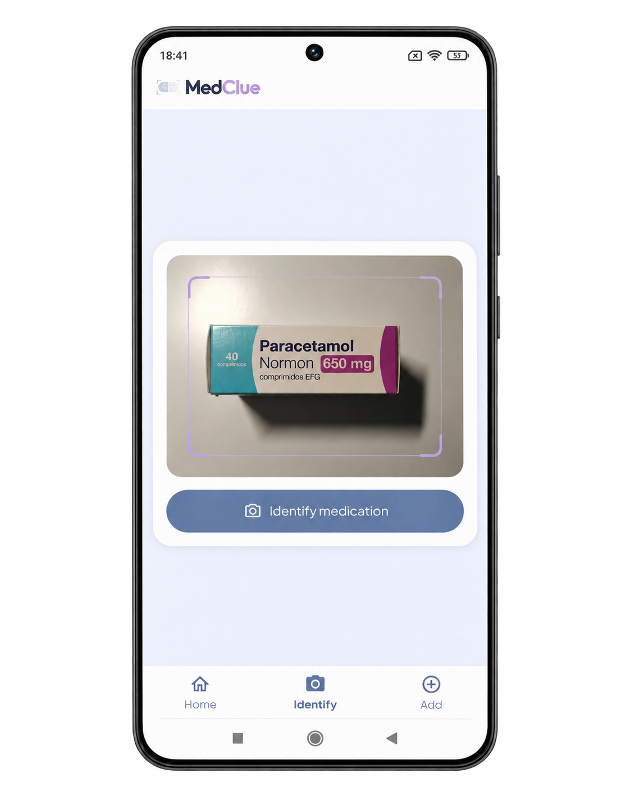
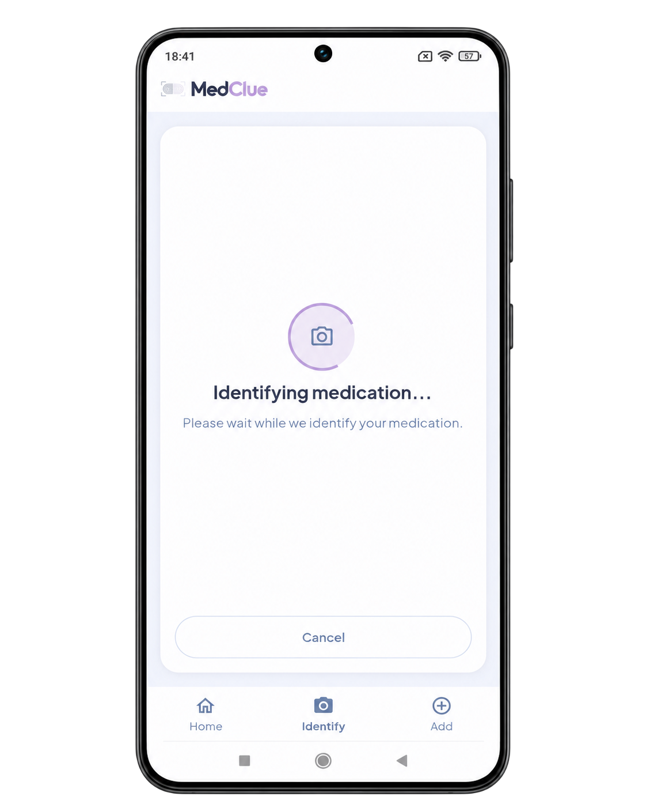
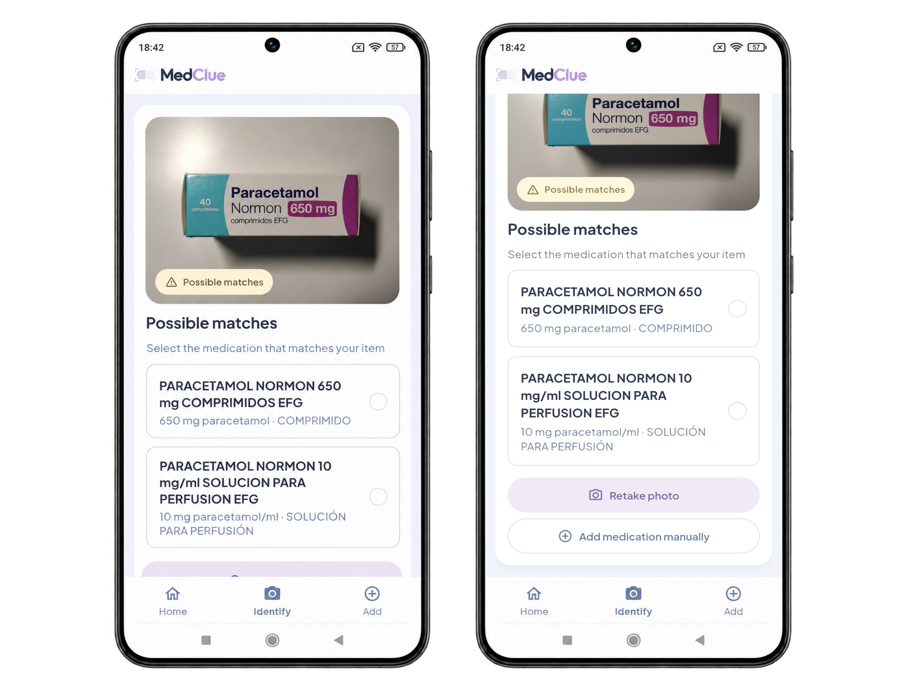
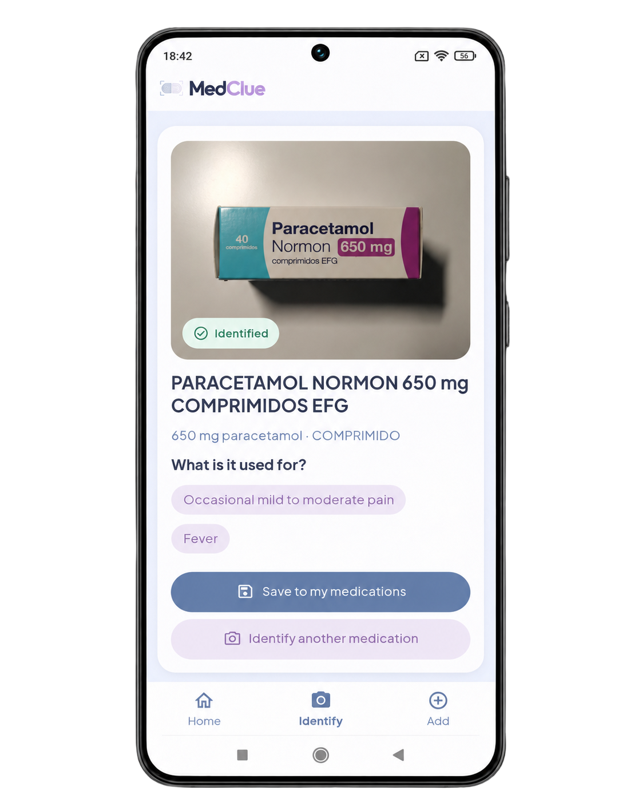
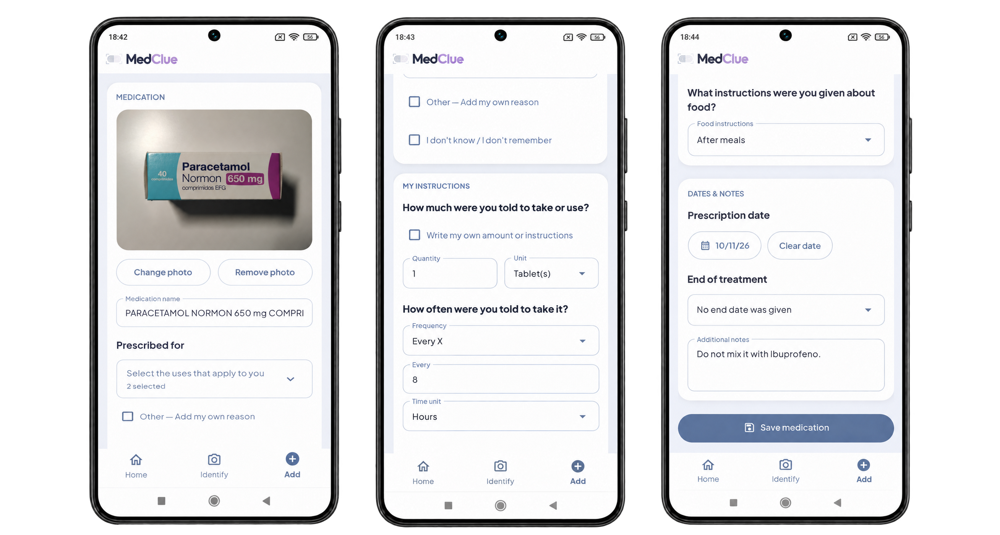
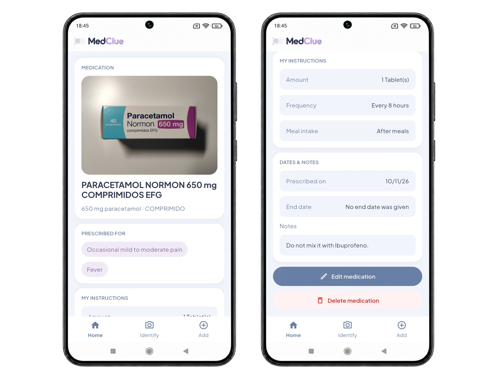

<p align="center">
  
</p>

# MedClue

[](https://github.com/aialaelejalde/MedClue/actions/workflows/tests.yml)

MedClue is an Android app that allows users to take a photo of a medication package to find out what it is used for. It uses AI and CIMA, Spain's official medicine database, to identify medications available in Spain and show their official uses in English when available. Users can also create and manage a personal medication cabinet.

## Motivation

Many people have medications at home without remembering what they are used for. After a medical appointment, it can also be difficult to remember why a medication was prescribed, how much to take or when to take it.

MedClue was created to help users identify these medications and keep their personal treatment instructions in one place.

## Features

- Identify medications from package photos using AI and CIMA, Spain's official medicine database.
- View official therapeutic indications in English.
- Choose between possible matches when identification is uncertain.
- Add medications manually or save identified medications.
- Store personal reasons for use, treatment instructions, dates and notes.
- Search, sort, edit and delete saved medications without an internet connection.

## Screenshots

### Personal medication cabinet

<p align="center">
  
</p>

### Medication identification

<p align="center">
  
  
</p>

### Possible matches and identification result

<p align="center">
  
  
</p>

### Add medication

<p align="center">
  
</p>

### Medication details

<p align="center">
  
</p>

The personal treatment information shown is example data, not medical advice.

## Technology stack

| Component | Technology |
| --- | --- |
| Android application | Python, Flet |
| Backend | Python, FastAPI |
| AI model | OpenAI GPT-6.1 Terra |
| Official medicine database | CIMA (AEMPS) |
| Local storage | SQLite |
| Cloud hosting | Google Cloud Run |
| Testing | Pytest |

Personal medication records are stored locally on the device. The backend connects to OpenAI and CIMA through HTTPS for medication identification.

## Project structure

```text
MedClue/
├── frontend/           # Android application
├── backend/            # FastAPI backend
├── docs/               # Project documentation and screenshots
├── .github/workflows/  # Automated testing workflows
├── .gitignore          # Files excluded from version control
├── LICENCE             # Project license
└── README.md           # Project overview
```

## Installation

1. Download the APK from [GitHub Releases](https://github.com/aialaelejalde/MedClue/releases/tag/v1.0.0).
2. Install it on your Android device.
3. Open MedClue and start using the application.

AI identification is fully implemented and has been tested using a backend deployed on Google Cloud Run. However, to avoid ongoing API costs, the public demo only supports offline medication management.

See the [deployment guide](docs/DEPLOYMENT.md) for prerequisites, environment variables, build and backend setup instructions.

## Testing and validation

- 1,065 automated tests passed (486 backend, 579 frontend).
- 16 functional acceptance tests performed on a real Android phone.
- AI identification evaluated with 30 photographs.
- English use labels compared with 16 official CIMA documents.
- Performance, offline functionality, data persistence, security and privacy checks completed.

See the [validation report](docs/VALIDATION.md) for results and test scope.

## Documentation

- [Requirements](docs/REQUIREMENTS.md)
- [Architecture](docs/ARCHITECTURE.md)
- [API](docs/API.md)
- [Deployment](docs/DEPLOYMENT.md)
- [Validation](docs/VALIDATION.md)

## Disclaimer

MedClue is an informational and personal medication management tool. AI identification may be incorrect. Always check the medication package and follow the instructions provided by healthcare professionals. The app does not provide medical advice.
