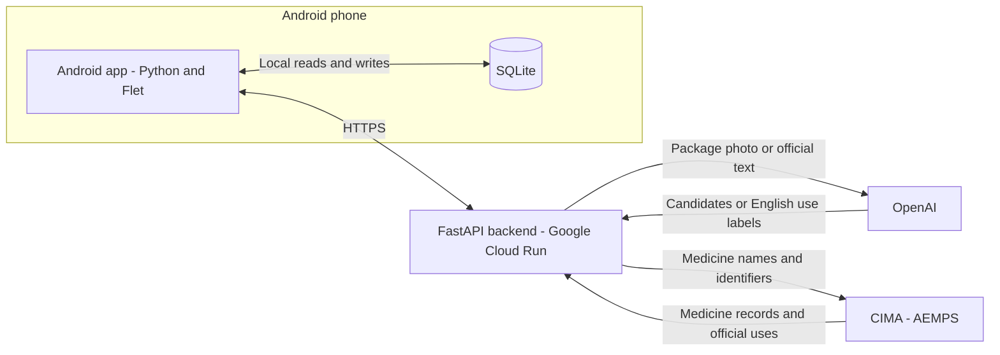
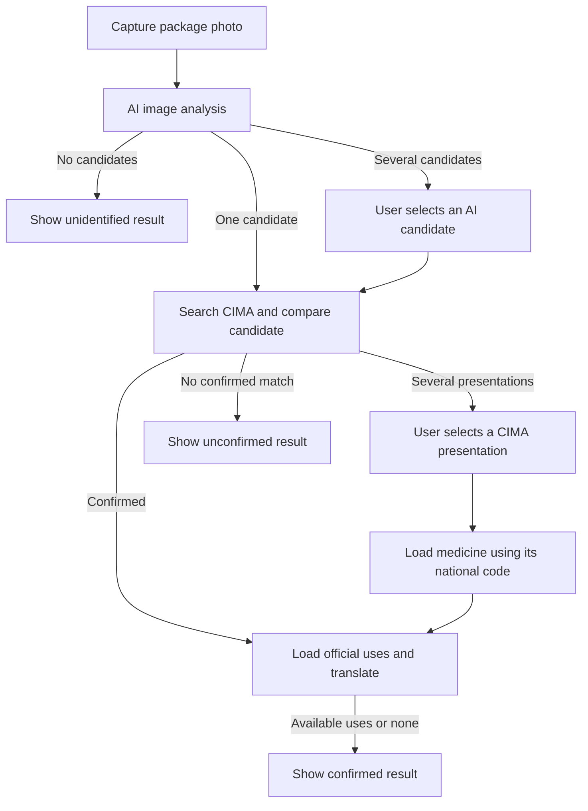

# MedClue architecture

## 1. Architecture overview

MedClue has two parts: an Android app and a cloud backend. The app manages the camera and personal medicine cabinet. The backend handles AI requests and CIMA checks.

This split keeps cabinet operations available offline and service credentials outside the mobile app. There is no cloud database for personal records.

## 2. Technology stack

| Component | Technology | Reason for selection |
| --- | --- | --- |
| Mobile app | Python + Flet | Allows me to develop mobile apps using Python, my strongest programming language. |
| Target platform | Android | Supports development, builds and device testing from Windows without a Mac. |
| Backend | Python + FastAPI | Uses a familiar language and a simple framework for building APIs. |
| Backend hosting | Google Cloud Run | Offers low initial cost, automatic scaling and no server management. |
| AI model | OpenAI GPT-6.1 Terra | Best image identification performance among the models evaluated. |
| Official medicine data | CIMA REST API from AEMPS | Provides free access to official Spanish medicine information. |
| Local storage | SQLite | Needs no database server, account or internet connection. |

The default model, `gpt-6.1-terra`, can be changed in backend settings without updating the app.

## 3. System components

### Android app

The [frontend](../frontend/) separates screens and forms from medicine validation, cabinet rules and database access. Camera handling manages permissions, capture and photo preparation.

An identification session holds the current photo, selected match and result in memory. A separate API client handles online requests. This keeps network handling outside the screens and allows the main logic to be tested without a phone.

### Backend

The [backend](../backend/) separates request handling from the identification process. Data models check the structure of requests, AI output and responses.

The identification service controls the order of work. Separate clients call OpenAI and CIMA. Other components compare medicine data, load and translate official uses, and sign or check retry tokens.

Calls to external services are asynchronous, so the backend can handle other requests while waiting.

## 4. Medication identification flow

1. **Capture and upload.** The app checks the photo and sends it without compression or resizing to maintain image quality and improve AI identification accuracy.
2. **AI image analysis.** OpenAI reads the visible name, strength and pharmaceutical form. Its instructions ask it to leave unclear details unknown. No candidates means the process ends without calling CIMA. Several candidates require user selection.
3. **CIMA matching.** The backend searches CIMA and reads the matching medicine records. Python rules compare names, strengths and forms, allowing known differences such as accents and equivalent units. Automatic confirmation needs one clear match with enough information.
4. **Multiple matches.** The backend groups equivalent CIMA presentations when possible. If several options remain, the app asks the user to choose. An AI candidate starts a CIMA search; a selected CIMA option is loaded by its national code. Neither path repeats image analysis.
5. **Official uses.** For a confirmed medicine, the backend loads section 4.1, Therapeutic indications, from CIMA. OpenAI turns the Spanish text into short English labels. Its instructions require the original meaning and restrictions to remain. The backend checks the output structure; it does not independently check the medical meaning of the translation.
6. **Result presentation.** The backend returns a status with confirmed data, possible matches or an unconfirmed suggestion. The app selects the matching result screen. Choosing to save passes available data to the local entry form.

## 5. Local data storage

The app uses one SQLite database in its application data directory. A single table stores medicine details, photos, reasons, instructions, dates and notes. Each record has an ID and creation time.

Uses are stored as a JSON list. Instructions with several options use JSON objects, so editing can restore the selected option and its values. Most missing values use `NULL`. Database writes use transactions to avoid partial changes.

Photos are stored as binary data in the same record. Before saving, Pillow corrects orientation, removes EXIF metadata and creates a JPEG at quality 85, with a maximum of 1600 pixels on its longest side. This reduces local storage use. A replacement photo is stored only after saving succeeds.

Cabinet operations read and write this database directly. They do not depend on the backend.

## 6. Error handling and recovery

The backend tracks the current processing step. A service error returns failure information rather than a CIMA no-match result. The app keeps the current photo and any available suggestion for retry or manual entry. Local storage errors leave form values available.

### Time limits

- **40 seconds:** one backend processing limit shared by image analysis, CIMA checks and loading and translating official uses.
- **45 seconds:** the app's total wait limit for each request, leaving a five-second margin for communication.

Choosing a match starts a new request and a new time limit. Time spent making the choice is not counted.

### Retries and confirmed medicines

If image analysis fails or finds no reliable name, retry sends the same photo again. For later failures, the backend creates a signed retry token containing the failed step and the available medicine data. If only translation failed, the token also contains the CIMA text already loaded.

Tokens expire after 15 minutes. The backend checks their signature, age and contents before continuing. Retry tokens allow the backend to continue without storing identification sessions.

If CIMA has confirmed the medicine but loading or translating uses fails, the response keeps the confirmed status and medicine, with an empty use list and a retry token. Retry continues from the failed step. The app also keeps that confirmed result if the retry loses its connection.

### Cancellation

Cancellation stops the app's active task and clears its session. Request IDs prevent old responses from changing the current screen. The backend monitors client disconnection and cancels its task when detected. An external AI request already running may not stop immediately.

## 7. Security and privacy

- **Transport and credentials:** The app accepts only HTTPS backend URLs. External service URLs also use HTTPS. The OpenAI API key and retry signing secret are loaded from backend environment settings, outside the Android app.
- **External data:** OpenAI receives the captured photo for analysis and CIMA text for English labels. CIMA receives medicine names and identifiers, not photos. Personal cabinet records are not uploaded. Both OpenAI calls set `store=False`.
- **Temporary photos:** The app holds captures in memory until they are saved or discarded. The backend processes uploads temporarily and closes the uploaded file after the request. It has no permanent photo store or identification history. External providers apply their own data policies.
- **Protection limits:** Retry tokens are signed, not encrypted. Saved records rely on Android storage protection, without added database encryption or a separate app lock. There is no user login or API authentication.
